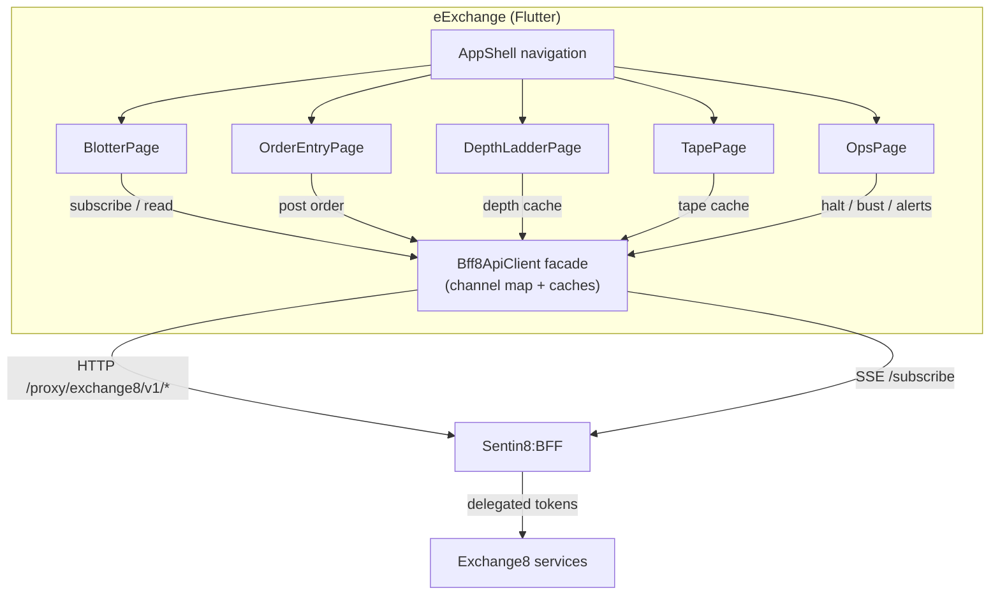

# eExchange - Exchange8 Trading App

## 1. Summary

eExchange is the Exchange8 vertical's Flutter client for traders and
exchange operations staff: live order blotter, order entry ticket, depth
ladder with BBO, trade tape, and the operations console (halts, busts). It
is a **BFF-only** client - every backend call routes through Sentin8:BFF
(`/proxy/exchange8/...`, `/subscribe` SSE); no service is ever addressed
directly. The app is a composition of the platform Flutter library
(`sdk/flutter/sentin8_flutter`) with the Exchange8 brand.

## 2. Motivation

Exchange8 needs the trader and operations surfaces available anywhere -
mobile/desktop - without a FIX console or a fat desktop terminal:

- A trader must see live order state (blotter), submit orders, and read
  the market (depth, BBO, tape) from a thin, tenant-aware client.
- Operations staff need halt/resume and trade-bust actions plus a read
  surface for surveillance alerts.
- OAuth tokens never reach the device - the BFF holds tokens server-side
  (architecture-principles §4.7), so the app keeps no secrets.
- Every backend surface is already scope-gated; feature gating in the app
  follows the provisioned scope map, while the server remains the sole
  authorization decision (Shield).

## 3. Architecture & High-Level Design

A single-page Flutter shell with five pages. One shared `Bff8ApiClient`
façade wraps the platform transport with Exchange8 channels and holds the
client-side caches (orders, books, tapes) the pages render. SSE
subscriptions deliver blotter, book, and tape updates; mutations go out as
BFF-proxied HTTP POSTs.

- **AppShell** - bottom navigation across the five surfaces; provides the
  `BffClientScope` inherited widget so all pages share one client instance.
- **Bff8ApiClient** (app-local façade) - wraps the platform
  `sdk/flutter/sentin8_flutter` transport: typed `get`/`post`,
  `subscribe(channel)` SSE stream, and the order/book/tape caches.
- **Pages** - `StreamBuilder` over SSE channels (blotter, depth, tape),
  forms issuing BFF POSTs (order entry, bust), and a `FutureBuilder` GET
  (alerts).

## 4. Key Traits and Data Structures

- `Bff8ApiClient` (app-local): the façade pages use - HTTP verbs, SSE
  subscription, and the order/book/tape caches. Concrete transport comes
  from `sdk/flutter/sentin8_flutter`.
- `BffClientScope`: `InheritedWidget` carrying the authenticated client
  down the widget tree; `BffClientScope.of(context)` is the pages' single
  access point.
- `BffEvent`: one SSE event - channel name + decoded JSON payload.
- `OrderRow`: the blotter row (`cl_ord_id`, status, qty, limit, timestamp).
- `BffError`: transport/HTTP errors surfaced to the UI as messages.

## 5. Rationale, Trade-offs, and Alternatives

- **BFF-only access (rejected: direct service calls).** Services are not
  exposed to clients, tokens never reach the device, and tenant resolution
  + scope down-scoping stay server-side.
- **InheritedWidget scope (rejected: global singleton).** A root-scoped
  inherited widget keeps the client explicit and injectable in widget
  tests - no mutable global state.
- **Façade-owned caches (rejected: per-page ephemeral state).** SSE events
  arrive incrementally while blotter/ladder/tape need the accumulated
  picture regardless of which page mounted first; one façade-owned cache
  keeps every page consistent.
- **SSE for market data (rejected: WebSocket).** Depth/BBO/tape/blotter are
  one-way server→client push - the platform subscription tier (`/subscribe`)
  is SSE; WebSocket is reserved for the bidirectional chat tier
  (architecture-principles §4.7a).
- **StreamBuilder over a state-management library.** Each surface is one
  event stream plus a small façade-owned cache; a heavyweight store adds
  ceremony with no cross-page write contention to manage.

## 6. Internal Implementation & Invariants (Private Design)

- **Single client instance.** `AppShell` creates exactly one façade; pages
  obtain it via `BffClientScope.of(context)` and never construct their own.
- **Cache ownership.** Order/book/tape caches are façade-owned; pages render
  read-only views (sorted/sliced at build time); SSE handlers are the only
  writers.
- **Idempotent order submission.** The ticket generates `cl_ord_id` per
  submit and the gateway dedupes on it - a retry after transport failure
  must reuse the id.
- **No secrets on device.** No tokens, session keys, or FIX credentials are
  persisted by the app; the platform shell owns authentication.
- **Scope-driven gating.** Feature enablement follows the provisioned scope
  map; pages never call endpoints outside their scope.

## 7. Unresolved Questions / Future Designs

- Transport bootstrap: the shell constructs the façade with a placeholder
  transport; wiring the authenticated platform transport (sign-in, org-env
  picker, refresh) is pending (DESIGN.md §10).
- Pegged/iceberg entry and a pre-submit risk preview are not yet on the
  ticket; cancel/amend and the order history drawer are not yet rendered.
- Whether mobile parity for sessions/feeds/customers admin (Dash RFW
  territory today) is wanted.
- Golden/widget tests under `test/` are pending (DESIGN.md §9).

Wire-level detail: `DESIGN.md`. Business functionality: `BUSINESS.md`.
App-Store listing manifest: `app-listing.json` (seeded via `make seed`).
Epic/phase history for this app: `BACKLOG.md` epic A1 at the workspace root.

---

**Architecture & Design:** exchange8:eexchange and its underlying concepts were designed by [Hamid Jahanzad](https://www.linkedin.com/in/hamidjahanzad/).
